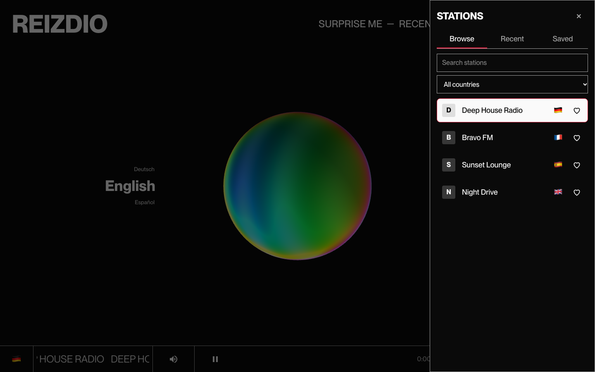

<h1 align="center">REIZDIO</h1>

<p align="center"></p>

<p align="center">Live web radio with a 3D visualizer that moves to whatever you're listening to.<br>
<a href="https://www.reiz.live">www.reiz.live</a></p>



## Features

- **Live radio, visualized.** A three.js blob reacts to the stream in real time, split into bass, mid and treble bands. It crossfades between idle and playing, and calms down under `prefers-reduced-motion`.
- **Pick by genre and language.** Scroll-pickers on desktop, chip rows on phones.
- **Station panel.** Browse, Recent and Saved tabs in a side drawer (bottom sheet on phones). Name search across all of Radio Browser with an optional country filter.
- **Surprise me.** Plays a random verified station from the current genre.
- **Recent.** The last 20 stations, kept in localStorage. No account needed.
- **Saved.** Heart a station to keep it. Email/password login via Supabase; saving while logged out opens login and completes the save afterwards.
- **Sharing.** `/s/[stationId]` opens the app on that station with a tap-to-play state (browsers block autoplay), and renders a generated OG image. The share button uses the native share sheet or copies the link.
- **Phone-ready.** Compact play bar and Media Session support for lock-screen and media-key controls.
- **Honest empty and error states.** Skeletons while stations verify, a clear message when a genre/language combo has nothing, with an "Any language" escape hatch.

## How it works

### Only streams the visualizer can read are listed

The visualizer needs the audio samples, which means the stream has to be fetched with `crossOrigin="anonymous"` and the server has to allow it. Many stations in Radio Browser don't: they omit CORS headers, or serve plain HTTP on an HTTPS page. Those would either fail to play or play without moving the blob, so they are filtered out up front.

`lib/radio/verify.ts` checks each candidate stream:

1. `url_resolved` must be `https:`.
2. A range request sent with `Origin: https://reiz.live` must return an `Access-Control-Allow-Origin` header. Only headers are inspected; the body is aborted immediately.
3. Each probe has a 3 s timeout, probes run in parallel, and verdicts are cached per URL for 24 hours.

List endpoints over-fetch about 150 candidates from Radio Browser and return the first 50 that pass. The typed Radio Browser client (`lib/radio/client.ts`) is server-only, and `app/api/stations/*` exposes list, search, random and by-id routes. If a stream still fails at playback time (an error, a stream that ends, or no audio within 15 s, either at start or while stuck buffering), the engine reports it, the station is dropped from the current list, and playback advances to the next one. After 5 failures in a row it stops and says so instead of cycling through a dead list.

### Audio engine to visualizer

`lib/audio/engine.ts` is a singleton that owns one `HTMLAudioElement` and one `AudioContext` + `AnalyserNode` for the lifetime of the app (the old version created a new context on every station change). It exposes `load`, `play`, `pause`, volume and mute, the analyser, and `playing` / `paused` / `blocked` / `failed` events (`blocked` means the browser wants a tap before audio may start; it never marks a station bad). `lib/audio/mediaSession.ts` mirrors it into the Media Session API.

`visualizer/` is a framework-agnostic three.js scene: `createVisualizer(container, getAnalyser)` returns `{ setActive, dispose }`. Each frame it reads the analyser, `bands.ts` reduces the spectrum to smoothed bass/mid/treble values, and they go straight into shader uniforms. Nothing about the audio passes through React state, so there is no re-render per frame. The renderer pauses while the tab is hidden and uses an adaptive pixel ratio on mobile.

React only holds the UI: `store/player.ts` (station, list, genre, language, play state, volume) and `store/auth.ts` are Zustand stores, `lib/library/recents.ts` persists recents, and `lib/library/saved.ts` maps `saved_stations` rows to stations.

## Stack

Next.js 16 (App Router) · React 19 · TypeScript · Tailwind CSS 4 · three.js 0.186 · Zustand · Supabase (`@supabase/ssr`) · Vitest + Testing Library · Playwright + axe

## Local setup

Requires Node 24.

```bash
npm install
cp .env.example .env.local
npm run dev
```

Open <http://localhost:3000>.

- **Supabase (optional).** Fill `NEXT_PUBLIC_SUPABASE_URL` and `NEXT_PUBLIC_SUPABASE_ANON_KEY` in `.env.local` to enable login and saved stations. If they are unset the app still runs, and login reports that it is unavailable.
- **Database.** Apply `supabase/migrations/*.sql` in the Supabase SQL editor. The migration drops and recreates `saved_stations`, so existing saved data is not preserved. Row-level security restricts each user to their own rows.
- **`RADIO_BROWSER_BASE`** selects the Radio Browser mirror and defaults to `https://de1.api.radio-browser.info`.

## Scripts

| Command | What it does |
|---|---|
| `npm run dev` | Dev server |
| `npm run build` / `npm start` | Production build and server |
| `npm run lint` | ESLint |
| `npm run typecheck` | `tsc --noEmit` |
| `npm test` | Vitest unit tests |
| `npm run e2e` | Playwright end-to-end and accessibility tests. Builds the app and uses a local Radio Browser fixture server and a test audio file, so it never touches live streams. |

CI (`.github/workflows/ci.yml`) runs lint, typecheck, unit tests and e2e on every push and pull request.

## Credits

- Station data from [Radio Browser](https://www.radio-browser.info/), a community-maintained directory.
- Typeface: PP Neue Montreal by [Pangram Pangram](https://pangrampangram.com). It is a commercial font, included in this repository for this project only and not licensed for reuse.
